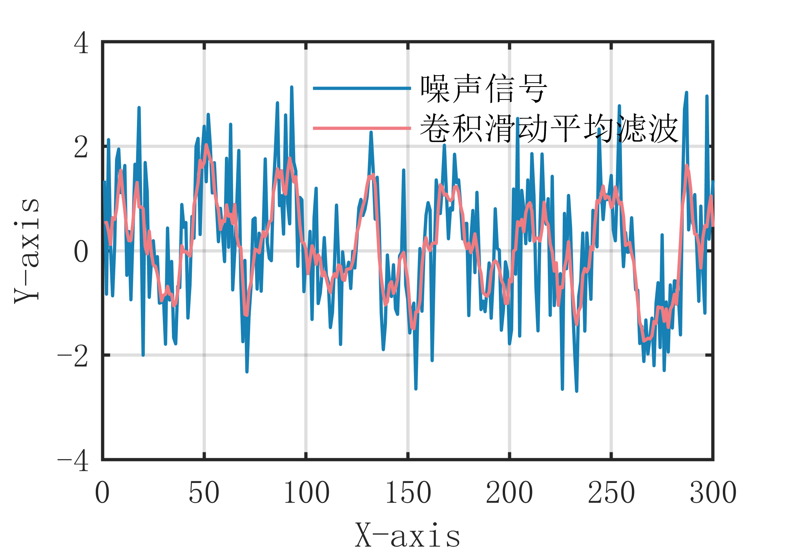

# MATLAB | Digital Signal Processing | Convolutional Moving Average Filtering Algorithm | Includes data and plotting code | Directly Useable

1. Basic Definition
The Convolutional Moving Average Filtering algorithm is a filtering method based on convolution operations. It calculates the moving average by performing convolution operation on the signal to eliminate noise. The main idea of this algorithm is to define the weight coefficients of the filter window as a convolution kernel, and perform convolution operation on the signal to obtain the smoothed signal. This can effectively remove periodic noise and high-frequency noise while preserving the overall trend of the signal. Specifically, the steps of the Convolutional Moving Average Filtering algorithm are as follows:
Define a filter window that includes the current sample point and several surrounding points.
Define the weight coefficients of the filter window as a convolution kernel.
Perform convolution operation on the signal and the convolution kernel to obtain the filtering result for the current sample point.
Move the filter window forward one position and repeat the above steps until all sample points have been processed. The advantage of the Convolutional Moving Average Filtering algorithm is that it can effectively remove periodic noise and high-frequency noise while preserving the overall trend of the signal; however, it requires selecting an appropriate size for the convolution kernel and weight coefficients, otherwise it may affect the filtering effect.
2. Definition and Outline Effects
The outline effects are as follows:
\n        \n  
Outline video tutorial operation:
\n        \n          \n          \n          \n          \n            To view this video please enable JavaScript, and consider upgrading to a\n            web browser that\n            supports HTML5 video\n

## Images

<!-- PAYMENT_BLOCK -->

## Get this dataset

- Payment link (Stripe): [Buy now](https://buy.stripe.com/3cs8yP7sY87d0vu9AB)
- Payment QR code: 

<!-- /PAYMENT_BLOCK -->
